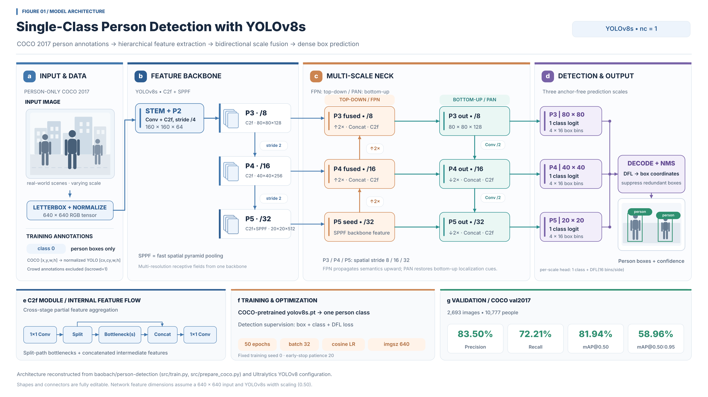

# Person Detection in Images

Course project. Team: Tejas Mahajan, Van Hoang Bao Bach.

## Problem
Detect and localize people in images with bounding boxes. The system must handle multiple people per image, different lighting, backgrounds and scales, and partial occlusion.

## Dataset
[COCO](https://cocodataset.org) (Common Objects in Context), `person` category only (COCO class id 0 in YOLO format).

## Approach
1. Preprocess: filter COCO to images with `person`, convert annotations to YOLO format.
2. Fine-tune a pretrained YOLO model on the person subset.
3. Evaluate: precision, recall, mAP@0.5, mAP@0.5:0.95.
4. Visualize detections on test images.
5. Error analysis: crowded scenes, small persons, occlusion. Try data augmentation and fine-tuning variants.

## Architecture


YOLOv8s fine-tuned to one class. A C2f and SPPF backbone feeds a bidirectional neck (FPN top-down, PAN bottom-up) and three anchor-free heads at strides 8, 16, and 32.

## Layout
```
configs/    dataset and training configs (YOLO data yaml)
src/        data preparation, training, evaluation, visualization scripts
notebooks/  exploration and result plots
data/       COCO images and labels (not committed)
runs/       trained YOLOv8s weights and metrics
report/     PDF report, architecture diagram, and sample detections
```

## Result
YOLOv8s was fine-tuned for 50 epochs on the COCO person training images and evaluated on COCO `val2017` (2,693 images, 10,777 people).

| Precision | Recall | mAP@0.5 | mAP@0.5:0.95 |
| --- | --- | --- | --- |
| 83.50% | 72.21% | 81.94% | 58.96% |

The weights are `runs/yolov8s_coco_person/weights/best.pt`. The write-up, with sample detections, is `report/person_detection_report.pdf`. Every validation image with people highlighted, plus the curves and confusion matrices, is in [`full-results/`](full-results/). Train again with:

```bash
uv run python src/train.py --model yolov8s.pt --epochs 50 --batch 32
```

## Setup
Environment is managed with [uv](https://docs.astral.sh/uv/).
```bash
uv sync                 # creates .venv and uv.lock from pyproject.toml
uv run python src/<script>.py
uv add <package>        # add a dependency
```
