# Full results

YOLOv8s fine-tuned for 50 epochs on the COCO person subset. The final epoch was the best checkpoint (`runs/yolov8s_coco_person/weights/best.pt`).

Validation is the COCO person `val2017` split: 2,693 images and 10,777 people.

| Precision | Recall | mAP@0.5 | mAP@0.5:0.95 |
| --- | --- | --- | --- |
| 0.837 | 0.722 | 0.819 | 0.590 |

Numbers are the last row of [metrics/results.csv](metrics/results.csv).

## Person highlighting

[detections/](detections/) is every validation image with each detected person boxed. The confidence threshold is 0.25, the same setting as the sample images in the report. At that threshold the model drew 9,712 boxes. 89 images have no box above the threshold. [detections.csv](detections.csv) lists every box in the original image pixel coordinates. Display copies are JPEG quality 85. Images longer than 1280 pixels on a side are scaled down; the CSV keeps the original coordinates.

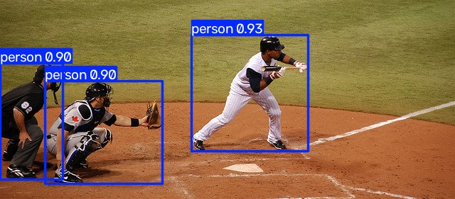
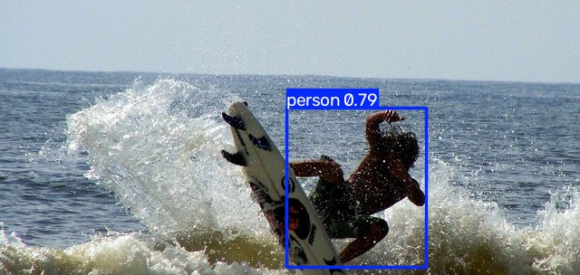
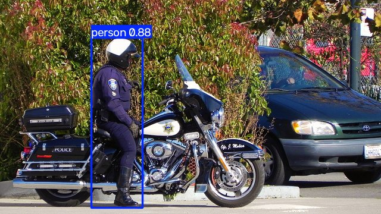
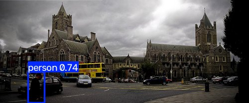
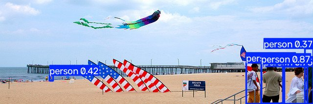
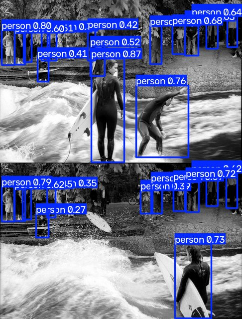

Ground truth and predictions from the training-time validation mosaics:

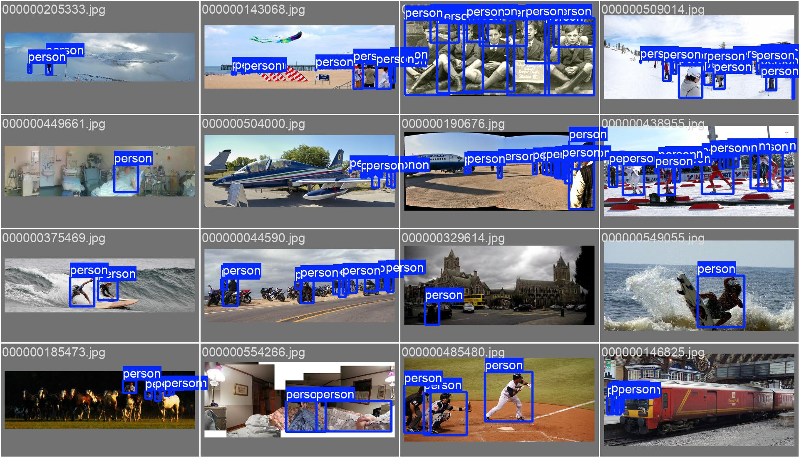
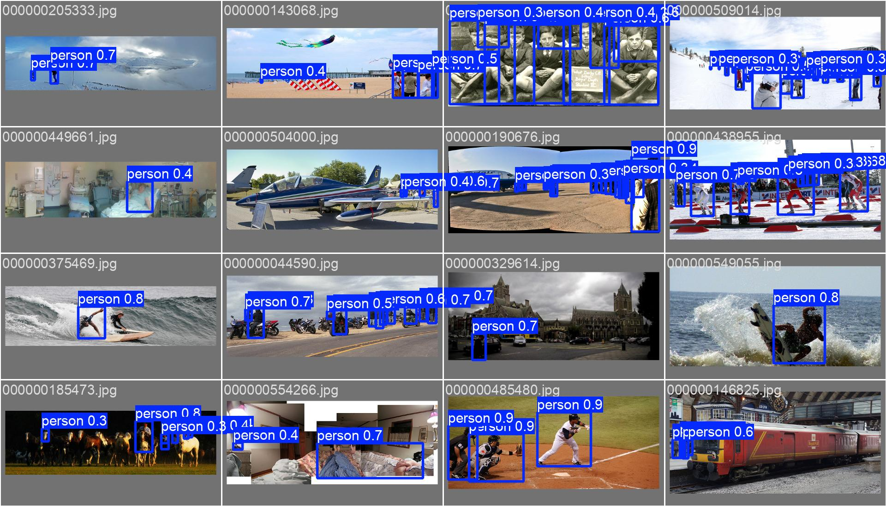

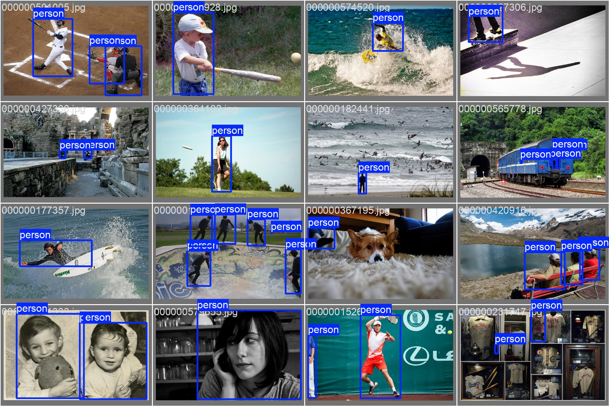
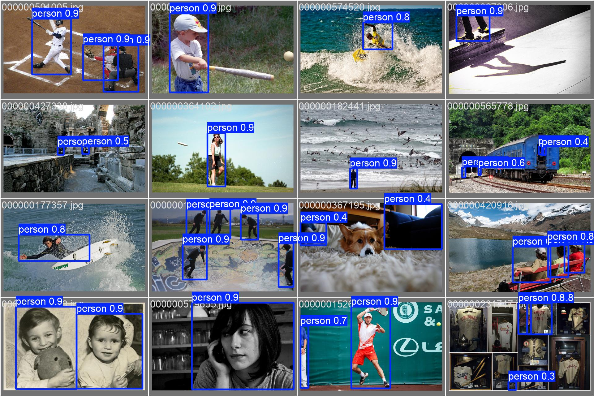

## Curves

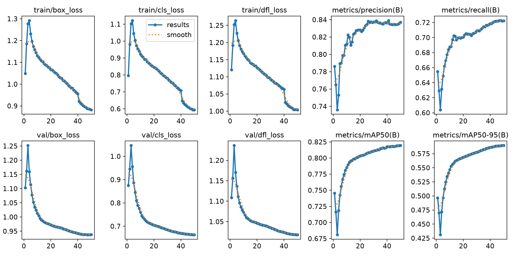

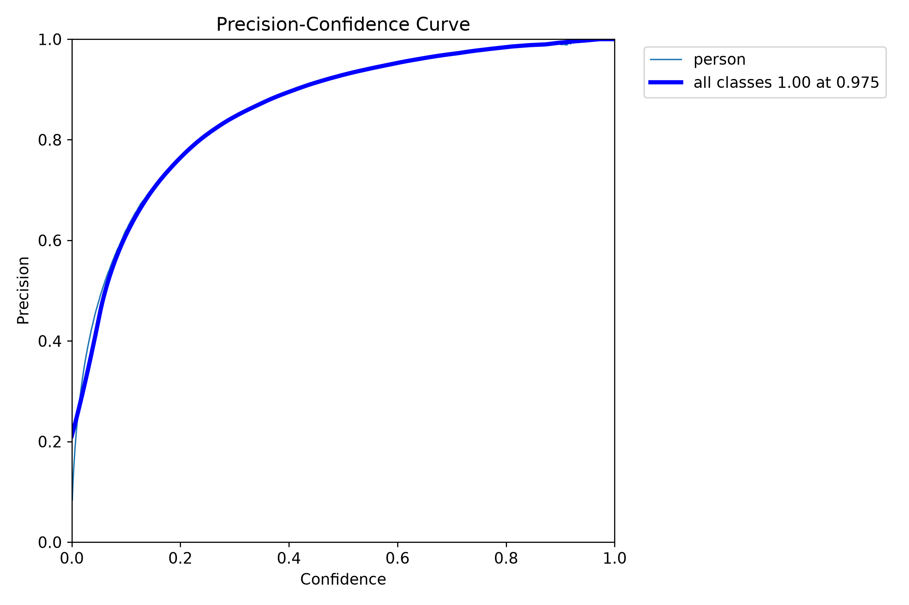
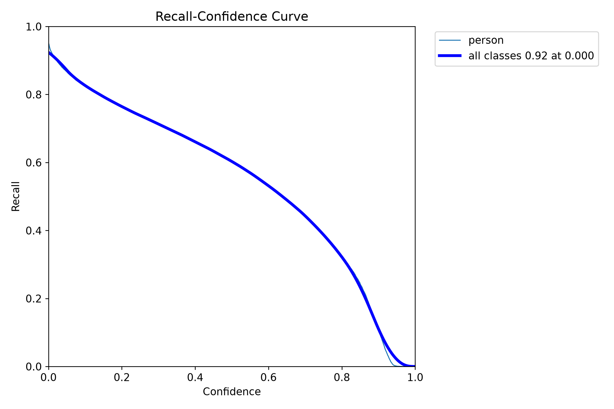
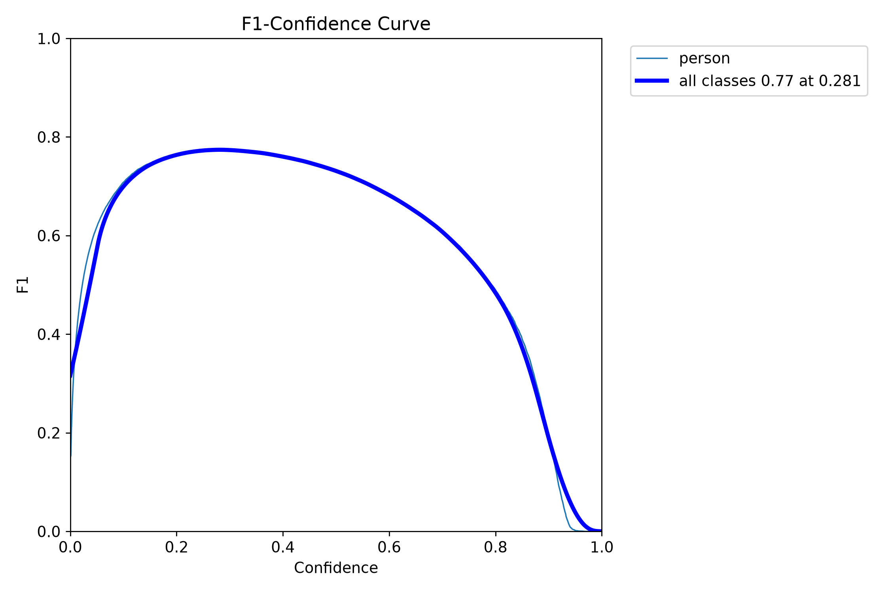
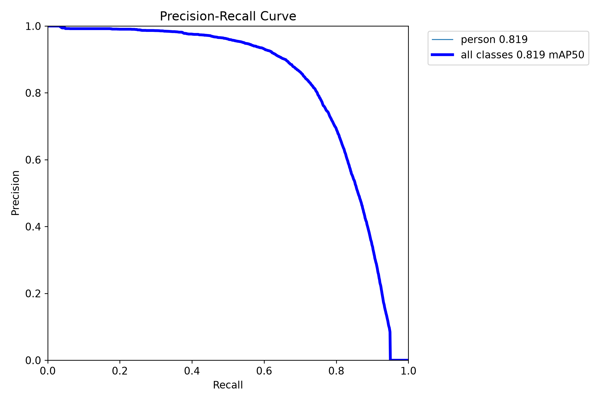

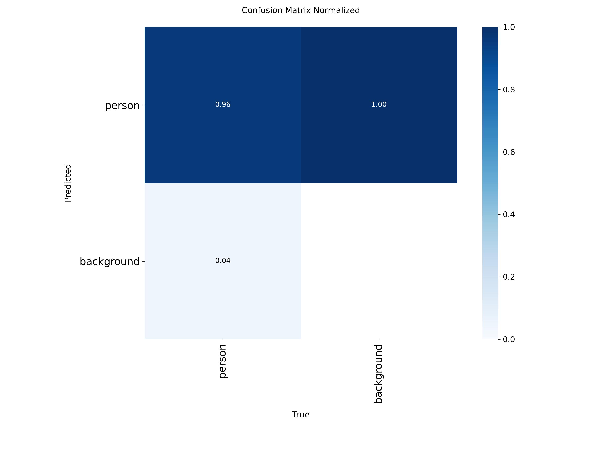

## Training samples

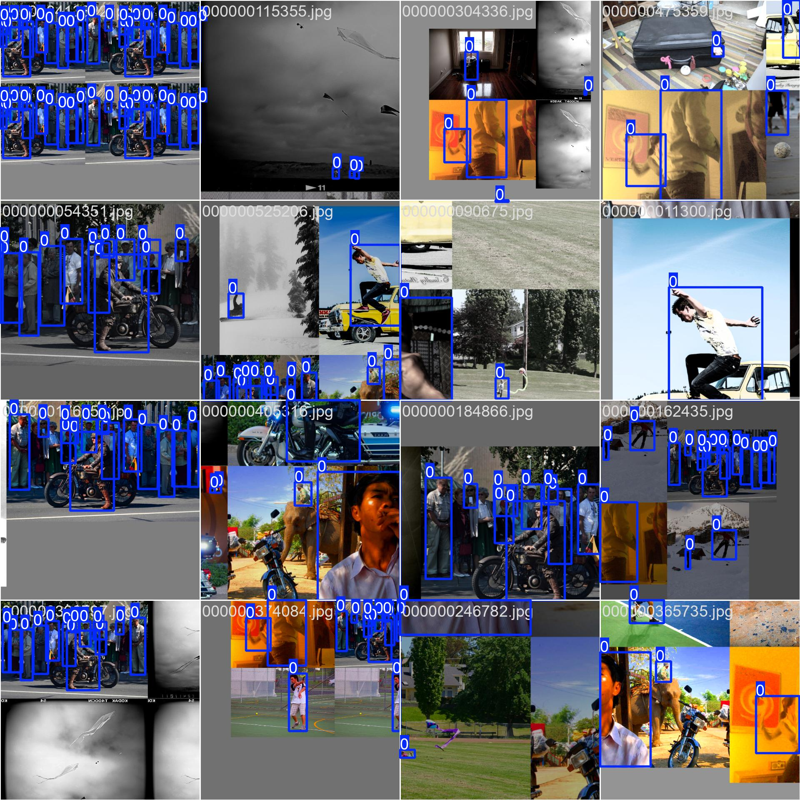
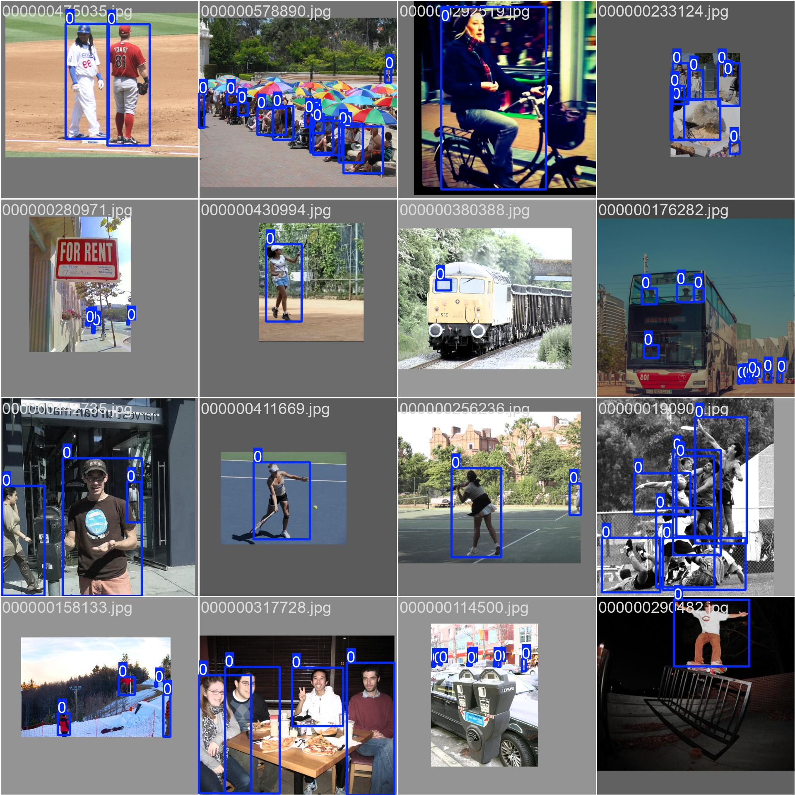

The label layout is [training-samples/labels.jpg](training-samples/labels.jpg). The training arguments are [metrics/args.yaml](metrics/args.yaml).

## Layout

- `detections/` — highlighted validation images
- `detections.csv` — one row per box
- `metrics/` — curves, confusion matrices, `results.csv`
- `training-samples/` — training batches
- `validation-mosaics/` — ground truth beside predictions
