# Abstract {.unnumbered}

Person detection is the task of finding every person in an image and placing a bounding box around each one. It is a standard problem in computer vision, and a first step for systems that have to notice people, from driving and robotics to search and surveillance. People are difficult to detect because they change in size, pose, and clothing, overlap in crowds, and are often partly hidden or poorly lit. This report presents a single-class person detector made by fine-tuning a pretrained YOLOv8s model on the person images of COCO 2017. We train for 50 epochs on 64,115 images and evaluate on the 2,693 person images of COCO val2017. Fine-tuning raises mAP@0.5 from 79.8% to 81.9% and mAP@0.5:0.95 from 57.0% to 59.0% compared with the original COCO-pretrained YOLOv8s, using only its person class. The error analysis shows that scale dominates the failures. Recall is 0.94 on large people and 0.50 on small people, and small people account for 75% of the misses. Accuracy also drops in crowded scenes and when more than half of the body is hidden. Lighting has little effect, and false alarms on empty background are rare. Without retraining, merging the predictions made at input sizes 640 and 960 raises COCO AP from 0.600 to 0.622, mostly by finding more small people.

# Introduction

Object detection is one of the central tasks in computer vision. Image classification assigns a label to a whole picture. Object detection also has to say where each object is. The output is a set of bounding boxes, a class label for each box, and a confidence score. The number of objects changes from image to image, objects can overlap, and the same kind of object can fill most of the frame or cover only a few pixels. A useful detector has to handle that range in a single pass over the image.

Person detection restricts the task to one class: person. It is one of the most studied forms of detection, because people are what many applications actually need, and because a person is among the most variable things in a photograph. Someone may stand, sit, walk, bend, or face away from the camera. Clothing, hair, bags, and uniforms change the appearance much more than they do for a rigid object such as a car or a traffic sign. The same person looks different at noon and at night, close to the lens and across a street.

The boxes are the input to a larger system. A vehicle uses pedestrian locations before it brakes or changes lanes. A robot uses them to keep a safe distance or to hand something to a person. Surveillance, crowd counting, and sports analysis follow people from frame to frame. Photo libraries and image search use the boxes to organize pictures. In driving and robotics, a missed person is the costly failure, and the box has to be tight enough for a later stage, such as tracking or pose estimation, to use it.

The conditions that make the problem hard show up in ordinary photographs. Distance from the camera sets the size: a person in the background may cover only a few dozen pixels, while a person in the foreground fills the frame. In a crowd, bodies overlap, so two people can look like one shape, and a correct box can be removed because it overlaps a neighbor's box. Furniture, other people, and the edge of the frame hide parts of the body, while the labeled box still covers the whole person, including the hidden part. Pose and viewpoint change which body parts are visible. Lighting runs from a dim indoor scene to harsh daylight. One model is expected to work across that whole range.

Detectors themselves have moved from hand-designed features to features learned by a convolutional network. Older methods slid a window over the image and scored each window with a fixed descriptor. Current methods predict boxes directly, either in one stage or by proposing regions and then classifying them. One-stage detectors such as YOLO are common when the detector has to be fast, because it is only one piece of a larger pipeline. Section 2 reviews that work.

Our goal was to build a deep-learning person detector, measure how well it works, and find out where it fails. We fine-tuned a pretrained YOLOv8s detector on the person images of COCO 2017 and evaluated it on COCO val2017. Our contributions are:

1. A complete pipeline: COCO person data preparation, fine-tuning, evaluation, and visualization, all reproducible from the repository.
2. A quantitative comparison with the original COCO-pretrained YOLOv8s, which shows what fine-tuning on one class adds.
3. An error analysis by person size, crowding, occlusion, and lighting, the conditions named in our proposal, plus a breakdown of the detector's false boxes.
4. An inference experiment with input size, test-time augmentation, and multi-scale merging. It improves the weakest case, small people, without retraining.

# Related work

**Classical person detection.** Dalal and Triggs [1] described each detection window with histograms of oriented gradients (HOG) and classified it with a linear SVM, scanned over an image pyramid. Deformable part models [2] added parts that can move relative to the root window, which helped with pose and partial occlusion. Both rely on hand-designed features and a sliding window. Dollár et al. [3] showed that these detectors fail mostly on small and occluded pedestrians.

**Two-stage CNN detectors.** R-CNN [4] classified region proposals with CNN features. Faster R-CNN [5] made the proposals part of the network with a region proposal network, so the detector trains end to end. These detectors are accurate but slower, because every proposal is classified in a second stage.

**One-stage detectors.** YOLO [6] treats detection as one regression from the image to boxes and class scores, so it runs in real time. SSD [7] predicts boxes from several feature maps to handle different object sizes. Feature pyramid networks (FPN) [8] and path aggregation networks (PAN) [9] fuse features across scales, which helps small objects. YOLOv8 [10] combines these ideas: a CSP-style backbone with C2f blocks, an FPN plus PAN neck, and an anchor-free head that predicts box sides with distribution focal loss [11]. Like all of these detectors, it removes duplicate boxes with non-maximum suppression (NMS).

**Scale and error analysis.** Singh and Davis [12] showed that CNN detectors work best on objects at the sizes they saw during training, and that changing the input resolution at test time helps small objects but hurts large ones. We see the same effect in Section 4.7. Hoiem et al. [13] proposed sorting false positives into localization, duplicate, and background errors. We use similar categories in Section 4.6.5.

# Method

## Model

We use YOLOv8s [10], the small variant (11.1 million parameters, 28.4 GFLOPs at 640x640). Figure 1 shows the architecture. The backbone extracts features at strides 8, 16, and 32 (maps P3, P4, P5). The neck fuses them top-down (FPN) and bottom-up (PAN). An anchor-free head on each of the three maps predicts, for every location, one person score and the distance to the four box sides. Each side is a distribution over 16 bins (distribution focal loss). NMS then removes overlapping boxes.

We start from the COCO-pretrained `yolov8s.pt` checkpoint, which detects 80 classes. For one class, Ultralytics replaces the classification layers of the head with a one-class version. The backbone, neck, and box-regression layers keep their pretrained weights.

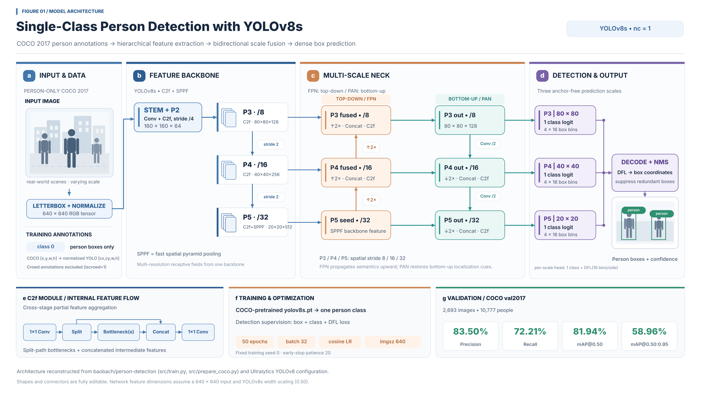{width=100%}

## Training

`src/train.py` fine-tunes the model with Ultralytics. `scripts/train_newton.slurm` runs it on one NVIDIA Tesla V100 (32 GB) on the UCF Newton cluster. The settings are:

* 50 epochs, input size 640, batch size 32, seed 0, early-stopping patience 20 (not triggered).
* Optimizer `auto`: for a run this long, Ultralytics selects an SGD-type optimizer with an initial learning rate of 0.01 and momentum 0.9, with 3 warmup epochs and a cosine learning-rate decay.
* Default Ultralytics augmentation: mosaic (four images in one), random scaling (gain 0.5), translation (0.1), horizontal flip (0.5), and HSV color jitter. Mosaic turns off for the last 10 epochs.
* Automatic mixed precision off, because its start-up check hung on the V100 nodes.

The loss is the YOLOv8 detection loss: CIoU box loss, binary cross-entropy for the person score, and distribution focal loss for the box sides. Training took 10 hours 52 minutes.

# Results

This section describes the dataset and the evaluation protocol, then gives the results and their analysis: the comparison with the pretrained model, training curves, sample detections, an error analysis by condition, an inference-time experiment, and the limitations of the study.

## Dataset

We use COCO 2017 [14], restricted to the person category. `src/prepare_coco.py` downloads the official annotations, keeps only images that contain at least one person, and fetches those images one by one from their COCO URLs, so the full 18 GB training archive is not needed. It converts each person box from COCO format (top-left corner, width, height in pixels) to YOLO format (center and size, normalized to the image) as class 0.

COCO marks large groups of people that cannot be separated as one *crowd* box (`iscrowd=1`). We drop these boxes from training, as the Ultralytics COCO converter does, and skip images whose only person annotations are crowd boxes. At evaluation time, COCO ignores detections inside crowd regions, and we do the same.

Table: COCO 2017 person subsets used in this project.

| Split | Images | Person boxes | Use |
| --- | --- | --- | --- |
| train2017 (person subset) | 64,115 | 257,253 | fine-tuning |
| val2017 (person subset) | 2,693 | 10,777 | validation and final evaluation |

COCO test2017 has no public labels, so val2017 serves as the evaluation set. Small people are common: 4,308 of the 10,777 validation people (40%) are smaller than 32x32 pixels, which COCO calls *small*. 3,723 are *medium* (up to 96x96 pixels) and 2,746 are *large*.

## Evaluation protocol

We report two families of metrics:

* **Ultralytics validation:** precision and recall at the confidence threshold that maximizes F1, mAP@0.5, and mAP@0.5:0.95. These match the training log.
* **Official COCO evaluation (pycocotools):** AP@0.5:0.95 overall and for small, medium, and large people. Its AP is about 1 point higher than the Ultralytics mAP@0.5:0.95 because the two interpolate the precision-recall curve differently.

For the error analysis, we fix the confidence threshold at 0.25, the setting used for the detection images. We match detections to people greedily by score at IoU 0.5, as COCO does. `src/evaluate.py` produces the comparison in Section 4.3, and `src/analyze.py` produces Sections 4.6 and 4.7.


## Fine-tuned vs pretrained

The table below compares the fine-tuned model with the original COCO-pretrained YOLOv8s, restricted to its person class, on the same 2,693 validation images.

Table: Fine-tuned vs pretrained YOLOv8s (person class) on COCO val2017.

| Model | Precision | Recall | mAP@0.5 | mAP@0.5:0.95 | COCO AP |
| --- | --- | --- | --- | --- | --- |
| Pretrained YOLOv8s | 82.75% | 69.77% | 79.76% | 57.02% | 0.588 |
| **Fine-tuned (ours)** | **83.50%** | **72.21%** | **81.94%** | **58.96%** | **0.600** |

Fine-tuning improves every metric: +2.2 points mAP@0.5, +1.9 points mAP@0.5:0.95, and +2.4 points recall. The gain is modest because the pretrained model already learned people from the same COCO training images, as one of its 80 classes. Fine-tuning specializes the whole network to one class. Section 4.6.1 shows that most of the gain is on small people.

## Training curves

Figure 2 shows the training curves. Validation mAP@0.5:0.95 starts at 0.497 after epoch 1, below the pretrained model, because the new one-class head starts from scratch. It dips to 0.431 in epoch 3, while the learning rate warms up to its peak, and recovers by epoch 5. It then rises steadily, passes the pretrained model (0.570) at epoch 22, and reaches 0.590 at epoch 50. The validation losses and mAP are flat over the last 5 epochs, without rising again, so the model does not overfit, and longer training at the same settings would add little.

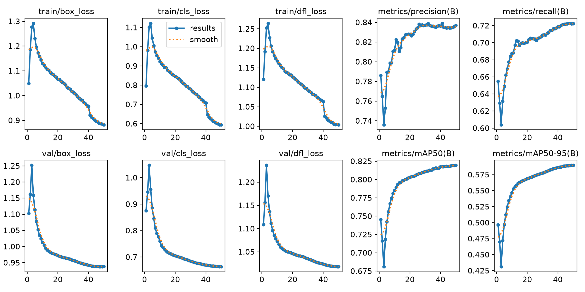{width=100%}

## Sample detections

The images below show detections at confidence 0.25 on validation images. The model finds clearly visible people of all sizes, including partly visible ones. Every validation image with its detections is in `full-results/detections/`.

::: {}
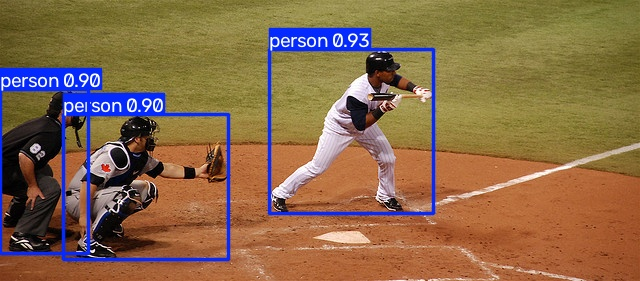{width=32%} 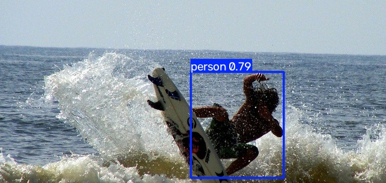{width=32%} 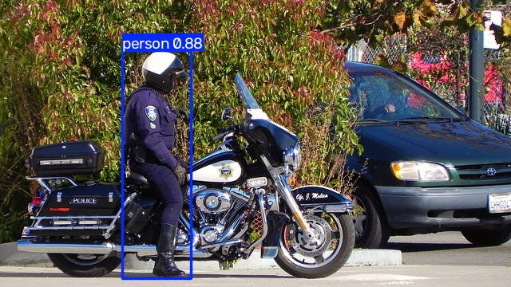{width=32%}
:::

*Sample detections on validation images: baseball game, surfer, officer on a motorcycle.*

## Error analysis

At confidence 0.25 the model draws 9,712 boxes and finds 7,875 of the 10,777 people (recall 0.731). Figure 3 summarizes recall and AP under the four conditions from our proposal.

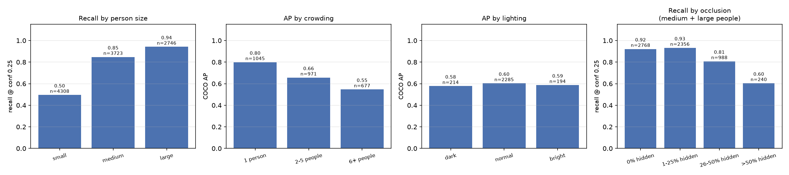{width=100%}

### Person size

Table: Recall and COCO AP by person size.

| Size | People | Found | Recall | COCO AP |
| --- | --- | --- | --- | --- |
| small (< 32x32 px) | 4,308 | 2,134 | 0.495 | 0.390 |
| medium | 3,723 | 3,155 | 0.847 | 0.685 |
| large (> 96x96 px) | 2,746 | 2,586 | 0.942 | 0.809 |

Size is the strongest factor. The model finds 94% of large people but only half of the small ones, and **75% of all missed people are small**. A small person covers only a few cells of the stride-8 map, so there is little visual evidence, and the box must be very precise to reach IoU 0.5. Fine-tuning helped most here: small-person AP rose from 0.363 (pretrained) to 0.390, while medium and large AP changed by less than 0.01.

### Crowded scenes

Table: COCO AP and recall by number of people in the image.

| People in the image | Images | People | COCO AP | Recall |
| --- | --- | --- | --- | --- |
| 1 | 1,045 | 1,045 | 0.799 | 0.922 |
| 2 to 5 | 971 | 2,863 | 0.656 | 0.783 |
| 6 or more | 677 | 6,869 | 0.547 | 0.680 |

AP falls by a third from single-person images to crowded ones. Two effects add up. People in crowds overlap, so NMS can remove a correct box that overlaps a higher-scoring box of a neighbor. Crowded scenes also contain more small, distant people: 64% of all validation people are in images with six or more people.

### Partial occlusion

COCO has no occlusion label, but it annotates 17 body keypoints for medium and large people and marks each one as visible or as labeled but hidden. We use the share of hidden keypoints as an occlusion measure. COCO has no keypoints for small people, so this analysis covers the 6,352 medium and large people with keypoints.

Table: Recall by share of hidden keypoints (medium and large people).

| Hidden keypoints | People | Recall | Recall (medium) | Recall (large) |
| --- | --- | --- | --- | --- |
| 0% | 2,768 | 0.922 | 0.885 | 0.956 |
| 1 to 25% | 2,356 | 0.932 | 0.904 | 0.974 |
| 26 to 50% | 988 | 0.808 | 0.785 | 0.871 |
| more than 50% | 240 | 0.604 | 0.568 | 0.703 |

Light occlusion does not hurt: recall stays at 0.92 to 0.93 when up to a quarter of the body is hidden. Recall then falls to 0.81, and to 0.60 when more than half of the body is hidden. The drop appears for medium and large people alike, so it is not a size effect. A heavily occluded person shows only a fragment, such as a head and shoulders behind a table, and the ground-truth box covers the full body, including the hidden part.

### Lighting

We measure lighting by the mean gray level of the image (0 to 255): dark below 70, bright above 160.

Table: COCO AP and recall by image brightness.

| Lighting | Images | People | COCO AP | Recall |
| --- | --- | --- | --- | --- |
| dark | 214 | 788 | 0.578 | 0.712 |
| normal | 2,285 | 9,408 | 0.603 | 0.732 |
| bright | 194 | 581 | 0.587 | 0.728 |

Lighting has a small effect. Dark images lose 0.025 AP and 2 points of recall. The HSV brightness augmentation during training and the wide variety of COCO photos make the model fairly robust to exposure. Mean brightness is a coarse measure, though: it does not capture a dark person against a bright background.

### Error types

We classify each box at confidence 0.25 as in [13]:

Table: Outcome of every box at confidence 0.25.

| Outcome | Boxes | Share |
| --- | --- | --- |
| correct (IoU >= 0.5 with an unmatched person) | 7,875 | 81.1% |
| inside a COCO crowd region (ignored by COCO) | 719 | 7.4% |
| localization error (0.1 <= IoU < 0.5 with a person) | 503 | 5.2% |
| background (no person nearby) | 382 | 3.9% |
| duplicate (second box on a person already found) | 233 | 2.4% |

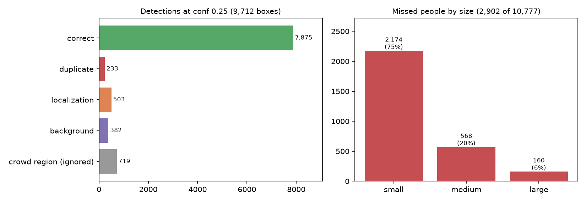{width=95%}

Real false alarms on the background are rare (3.9% of boxes). Most wrong boxes are near a person: poorly placed boxes on partly visible people, or boxes that cover two overlapping people. Many of the 719 boxes inside crowd regions are probably correct detections of individual people in an unlabeled group, which COCO neither rewards nor penalizes. The 2,902 missed people matter more than the 1,118 false boxes (localization, background, and duplicate errors), and the misses are mostly small people.

### Failure examples

The images below show typical failures. Green boxes are people found, yellow boxes are people missed, and red boxes are false boxes.

::: {}
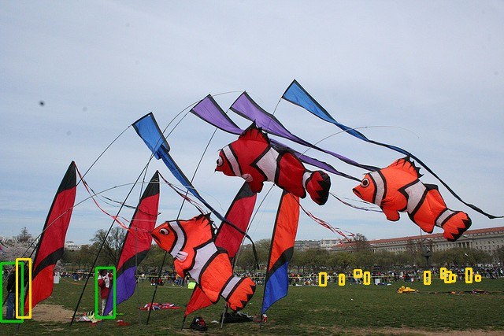{height=5.2cm} 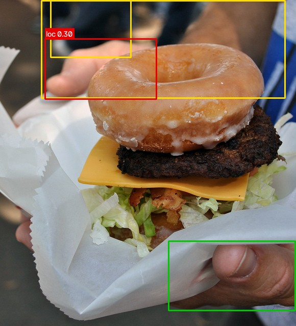{height=5.2cm}

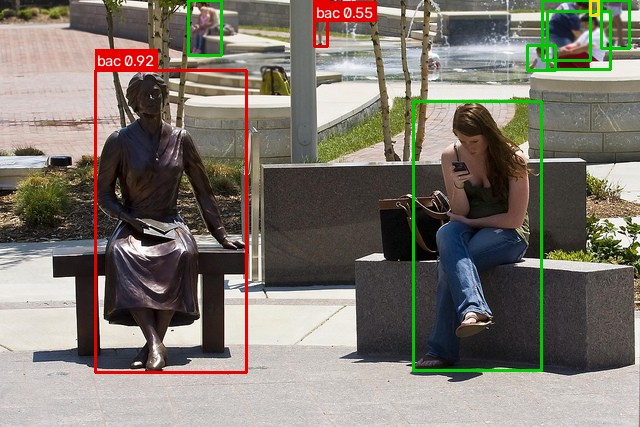{height=5.2cm} 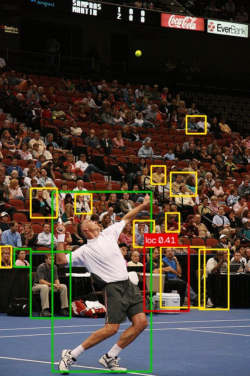{height=5.2cm}
:::

*Failure cases. Top left: 11 of 13 people are missed; all are far away and small. Top right: the people holding the food are hidden except for their hands; one is missed, and a box near the arm is too loose (localization error, confidence 0.30). Bottom left: a bronze statue of a seated woman is detected as a person with confidence 0.92 (background error). Bottom right: a dark arena where 10 of 13 labeled people are missed, mostly spectators in the dim stands; the red box is a loose box around a seated man (localization error, 0.41). COCO does not label every spectator, so some unlabeled people are also visible.*

## Experiment: input size and test-time augmentation

Small people are the main weakness, and they are small partly because the image is shrunk to 640 pixels. We tested, without retraining, whether more resolution helps:

* **960 and 1280:** the same weights at a larger input size.
* **640 + TTA:** Ultralytics test-time augmentation, which also predicts on flipped and rescaled copies and merges the results.
* **640 + 960 merged:** both predictions combined per image with NMS at IoU 0.7, the model's own NMS threshold (see Section 4.8 for other values).

\begingroup\small

Table: Same fine-tuned weights under different inference settings.

| Setting | AP | AP S | AP M | AP L | Recall | Recall S | False boxes | ms/img |
| :-- | :-: | :-: | :-: | :-: | :-: | :-: | :-: | :-: |
| 640 | 0.600 | 0.390 | 0.685 | 0.809 | 0.731 | 0.495 | 1,118 | 7.2 |
| 960 | 0.606 | 0.455 | 0.702 | 0.719 | 0.766 | 0.583 | 1,484 | 13.3 |
| 1280 | 0.551 | 0.473 | 0.694 | 0.517 | 0.773 | 0.630 | 2,136 | 21.4 |
| 640+TTA | 0.599 | 0.382 | 0.682 | 0.824 | 0.758 | 0.524 | 2,092 | 11.4 |
| **640+960** | **0.622** | 0.445 | 0.705 | 0.796 | 0.791 | 0.607 | 2,057 | 20.4 |

\endgroup

AP S, M, L: COCO AP for small, medium, and large people. Recall and false boxes at confidence 0.25. Time per image on one TITAN RTX; 640+960 needs both passes.

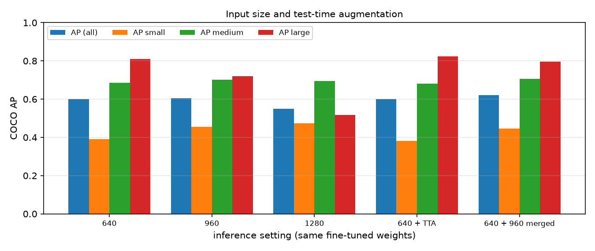{width=90%}

Larger inputs help small people a lot: small-person AP rises from 0.390 to 0.455 at 960 and 0.473 at 1280, and their recall from 0.50 to 0.63. But large-person AP falls from 0.809 to 0.719 and then 0.517. The model was trained at 640, so at 1280 a large person appears twice as big as anything it saw in training. This is the train/test scale mismatch described by Singh and Davis [12]. At 1280 the losses outweigh the gains.

Merging the 640 and 960 predictions keeps the strengths of both: 640 supplies the large people and 960 adds the small ones. Overall AP rises from 0.600 to **0.622** (+2.2 points), with small-person AP +5.5 points and large-person AP only -1.3 points. Recall at confidence 0.25 rises from 0.731 to 0.791, and for small people from 0.50 to 0.61. The costs are two forward passes per image (20.4 ms instead of 7.2 ms) and more false boxes at the same threshold (2,057 instead of 1,118). An application that needs fewer false alarms can raise the threshold, since the AP gain holds over the whole precision-recall curve. Ultralytics TTA does not help, because it adds flipped and *down*-scaled copies, while small people need *up*-scaling.

This experiment covers the "data augmentation" part of our proposal at test time only. A natural next step is to fine-tune at 960, or with stronger scale augmentation, so the model sees small people at a usable size during training. We could not run it in time: one 50-epoch run takes about 11 hours on a V100.

## Limitations

* **No separate test set.** COCO test2017 labels are not public, so val2017 is both the validation set during training and our final test set. We did not tune training hyperparameters on it. Ultralytics keeps the checkpoint with the best validation mAP (`best.pt`), but the last 5 epochs differ by less than 0.001 mAP, so the selection bias is negligible.
* **Analysis settings.** We set the lighting and occlusion bins from the distribution of brightness and hidden keypoints, before computing any accuracy for them. For the 640 + 960 merge we tried NMS IoU 0.5, 0.6, and 0.7 (AP 0.614, 0.620, 0.622) and report 0.7, the model's default. A setting chosen on a separate set could be slightly lower.
* **One training run.** We have one seed and one training configuration. A difference of less than about 0.5 AP between settings may be noise.
* **Proxies for conditions.** Occlusion is measured with keypoint visibility (medium and large people only), and lighting with mean image brightness. Neither is an exact label.
* **COCO crowd regions** are ignored, so we cannot measure performance inside dense groups.

## Code and reproducibility

All code, the trained weights, and the results are in the repository: <https://github.com/baobach/person-detection>.

```bash
uv sync
uv run python src/prepare_coco.py         # COCO person subset, YOLO format
uv run python src/train.py --epochs 50    # fine-tune (about 11 h, V100)
uv run python src/evaluate.py --device 0  # Section 4.3
uv run python src/analyze.py --device 0   # Sections 4.6 and 4.7
```

Weights: `runs/yolov8s_coco_person/weights/best.pt`. Detection images: `full-results/`. Numbers: `report/eval/results.md` and `report/analysis/results.md`.

# Conclusion

A YOLOv8s detector fine-tuned on the 64,115 COCO person images reaches 81.9% mAP@0.5 and 59.0% mAP@0.5:0.95 on COCO val2017, about 2 points above the original COCO-pretrained model. Its recall drops from 0.94 for large people to 0.50 for small ones, small people make up 75% of the misses, and accuracy falls in crowded scenes and for people more than half hidden. Lighting matters little, and real background false alarms are rare. Running the same weights at 640 and 960 and merging the results improves AP to 0.622, mostly by finding more small people. Future work: fine-tune at higher resolution, try a larger model (YOLOv8m), and tune NMS for crowded scenes.

**What I learned.** Building the data and evaluation code taught me how much the evaluation protocol shapes the result. Handling COCO crowd regions, choosing between the Ultralytics and the official COCO metrics, and matching boxes the same way COCO does all changed the numbers, so I had to understand each choice before I could trust any table. The error analysis was the most useful part for me: a single mAP value said the model was good, but splitting the people by size, crowding, occlusion, and lighting showed that small people cause three quarters of the misses and that lighting barely matters. The input-size experiment showed me the train/test scale mismatch in practice: a larger input helps small people and hurts large ones, and merging two sizes keeps the gains of both without retraining.

# References {.unnumbered}

[1] N. Dalal and B. Triggs, "Histograms of oriented gradients for human detection," in *Proc. CVPR*, 2005.

[2] P. F. Felzenszwalb, R. B. Girshick, D. McAllester, and D. Ramanan, "Object detection with discriminatively trained part-based models," *IEEE TPAMI*, vol. 32, no. 9, 2010.

[3] P. Dollár, C. Wojek, B. Schiele, and P. Perona, "Pedestrian detection: An evaluation of the state of the art," *IEEE TPAMI*, vol. 34, no. 4, 2012.

[4] R. Girshick, J. Donahue, T. Darrell, and J. Malik, "Rich feature hierarchies for accurate object detection and semantic segmentation," in *Proc. CVPR*, 2014.

[5] S. Ren, K. He, R. Girshick, and J. Sun, "Faster R-CNN: Towards real-time object detection with region proposal networks," in *Proc. NeurIPS*, 2015.

[6] J. Redmon, S. Divvala, R. Girshick, and A. Farhadi, "You only look once: Unified, real-time object detection," in *Proc. CVPR*, 2016.

[7] W. Liu, D. Anguelov, D. Erhan, C. Szegedy, S. Reed, C.-Y. Fu, and A. C. Berg, "SSD: Single shot multibox detector," in *Proc. ECCV*, 2016.

[8] T.-Y. Lin, P. Dollár, R. Girshick, K. He, B. Hariharan, and S. Belongie, "Feature pyramid networks for object detection," in *Proc. CVPR*, 2017.

[9] S. Liu, L. Qi, H. Qin, J. Shi, and J. Jia, "Path aggregation network for instance segmentation," in *Proc. CVPR*, 2018.

[10] G. Jocher, A. Chaurasia, and J. Qiu, "Ultralytics YOLOv8," 2023. [Online]. Available: https://github.com/ultralytics/ultralytics

[11] X. Li, W. Wang, L. Wu, S. Chen, X. Hu, J. Li, J. Tang, and J. Yang, "Generalized focal loss: Learning qualified and distributed bounding boxes for dense object detection," in *Proc. NeurIPS*, 2020.

[12] B. Singh and L. S. Davis, "An analysis of scale invariance in object detection - SNIP," in *Proc. CVPR*, 2018.

[13] D. Hoiem, Y. Chodpathumwan, and Q. Dai, "Diagnosing error in object detectors," in *Proc. ECCV*, 2012.

[14] T.-Y. Lin, M. Maire, S. Belongie, J. Hays, P. Perona, D. Ramanan, P. Dollár, and C. L. Zitnick, "Microsoft COCO: Common objects in context," in *Proc. ECCV*, 2014.

# My contribution {.unnumbered}

Submitted by Van Hoang Bao Bach. Teammate: Tejas Mahajan. We both wrote the main code and the main sections of this report, and we both worked through the analysis. The notes below say who led each piece.

## Van Hoang Bao Bach {.unnumbered}

**Code.** I led the data and measurement half of the pipeline and wrote it with Tejas: `src/prepare_coco.py` (64,115 training images, crowd boxes dropped, YOLO labels), `src/evaluate.py` (our checkpoint against the pretrained YOLOv8s person class, with COCO AP by size and by crowding), and `src/analyze.py` (occlusion, lighting, error types, and the input-size experiment). With Tejas, I also wrote `src/train.py` and `scripts/train_newton.slurm` and took part in the training run. The job stages the environment on node-local disk and turns automatic mixed precision off, because the AMP startup check hung on the V100 nodes. The run was 50 epochs on one Tesla V100 (10 hours 52 minutes), and the checkpoint is `runs/yolov8s_coco_person/weights/best.pt`.

**Report.** I led related work, data, method, error analysis, the scale experiment, limitations, and the conclusion, and I wrote those sections with Tejas. I rewrote the README so the pipeline can be rerun from the reproducibility section. With Tejas, I also wrote the abstract, the introduction, and the results section.

**Discussion and analysis.** Tejas and I turned the four conditions from our proposal into measurements. Occlusion is the share of hidden COCO keypoints, on the medium and large people who have keypoints. Lighting is the mean gray level of the image, with dark below 70 and bright above 160. We classified every box at confidence 0.25 as correct, inside a crowd region, a localization error, a background false alarm, or a duplicate, following Hoiem et al. We ran the same weights at 640, 960, and 1280, with test-time augmentation, and with the 640 and 960 predictions merged. A larger input finds more small people and loses large ones, because the network was trained at 640, and merging 640 with 960 is what raises COCO AP from 0.600 to 0.622. That reading is Section 4.7.

## Tejas Mahajan {.unnumbered}

**Code.** Tejas led the training half of the pipeline and wrote it with me: `src/train.py` and `scripts/train_newton.slurm`, the 50-epoch run, and `full-results/` (all 2,693 validation images with person boxes at confidence 0.25, `detections.csv` with 9,712 boxes, and the curves and confusion matrices). With me, he also wrote `src/prepare_coco.py`, `src/evaluate.py`, and `src/analyze.py`.

**Report.** Tejas led the abstract, the introduction, and the results section, and he wrote those with me. That covers the training setup, the metric table, the training curves, and the sample detections. He made the YOLOv8s architecture figure and chose the images in `report/samples/`. With me, he also wrote the method, the error analysis, and the input-size experiment. The short results summary is `report/person_detection_report.pdf`.

**Discussion and analysis.** Tejas and I read the training curves and the validation pictures together. The curves show the warmup dip, the recovery by epoch 5, and the best checkpoint at epoch 49, with epoch 50 within 0.0001 mAP. The boxed validation images show the pattern in Section 4.6: small and distant people are the usual misses, and some false boxes fall on background, such as the low-confidence box on the flags in the beach scene. We checked the headline metrics against the training log and `full-results/metrics/results.csv`, and we interpreted the size, crowding, and scale results together.
